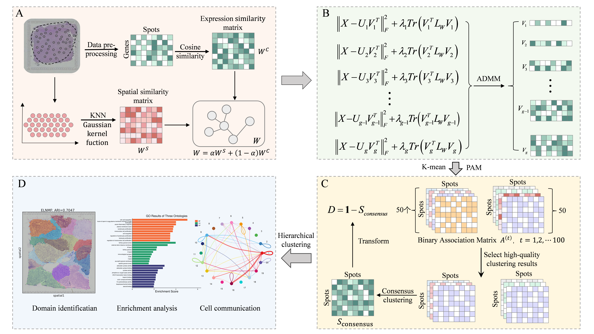

# ELNMF

ELNMF is an interpretable ensemble framework for spatial domain identification in spatial transcriptomics. It integrates multiple graph-regularized non-negative matrix factorization (NMF) solutions through quality-based partition filtering and consensus clustering.

## Overview

A hybrid graph encodes spatial proximity and gene expression similarity for NMF regularization. Candidate representations are generated across combinations of latent dimensions and graph-regularization strengths, and each representation is clustered independently using K-means and PAM. The resulting partitions are evaluated using a quality score that combines the Silhouette coefficient with the CHAOS score, both computed in the corresponding NMF latent space. Low-quality partitions are discarded, and the retained partitions are integrated through consensus clustering to reduce dependence on any single parameter configuration.

The main methodological contribution is the ensemble framework combining parameter-diverse NMF representations, quality-based partition filtering, and consensus integration. The hybrid graph serves as a supporting component for representation learning.


## Framework

<p align="center">
  
</p>

**Figure 1.** Schematic overview of ELNMF. (A) Hybrid graph construction integrates spatial proximity and gene expression similarity. (B) Graph-regularized NMF generates latent representations across multiple parameter configurations. (C) Each representation is clustered independently; the resulting base partitions are scored and filtered before their co-association matrices are averaged for consensus clustering. (D) The identified spatial domains and factorization outputs support downstream analyses, including functional enrichment and cell–cell communication analysis.

## Requirements

The ELNMF analysis scripts use R. The runtime and memory monitoring launchers (`.ps1`) require Windows and PowerShell, including access to Windows process information. The original repository documentation reports R 4.5.2. These are reported environments, not a verified minimum-version requirement. RStudio is optional.

The current scripts use the following packages:

```r
required_packages <- c(
  "Seurat", "hdf5r", "ggplot2", "patchwork", "Matrix",
  "mclust", "aricode", "FNN", "dbscan", "igraph",
  "cluster", "dplyr"
)
missing_packages <- setdiff(required_packages, rownames(installed.packages()))
if (length(missing_packages) > 0) install.packages(missing_packages)
```


## Repository structure

```text
ELNMF/
  data/
    Human_Breast_Cancer/
    MVC/
    DLPFC/
  main/
    ELNMF.R
    MVC_initialization_stability.R
    shared/
      hybrid graph.R
      NMF.R
      ensemble_clustering_filtered.R
      aggregative_indicator.R
      filter_top.R
    ELNMF_dataset_cost/
      HBC_benchmark.R
      MVC_benchmark.R
      DLPFC_151672_benchmark.R
      run_elnmf_computational_cost.ps1
      plot_elnmf_computational_cost.R
    HBC_method_comparison/
      HBC_CGNMF_benchmark.R
      HBC_Seurat_benchmark.R
      HBC_stHGC_benchmark.py
      HBC_MNMST_benchmark.py
      run_HBC_baseline_benchmark.ps1
      plot_HBC_method_computational_comparison.R
    ELNMF_scalability/
      HBC_ELNMF_scaling_benchmark.R
      run_HBC_ELNMF_scaling_benchmark.ps1
      run_HBC_ELNMF_consensus_memory_resume.ps1
      plot_HBC_ELNMF_scaling.R
  ELNMF_overview.png
  README.md
  LICENSE
```

| Entry point or directory | Purpose |
|---|---|
| `main/ELNMF.R` | HBC preprocessing, hybrid graph construction, NMF, filtering, consensus clustering, and ARI/NMI evaluation |
| `main/MVC_initialization_stability.R` | MVC random-initialization stability analysis with seeds 1–20 |
| `main/ELNMF_dataset_cost/` | ELNMF runtime and peak-memory measurements on HBC, MVC, and DLPFC section 151672 |
| `main/HBC_method_comparison/` | HBC computational-cost measurements for CGNMF, Seurat, stHGC, and MNMST, and comparison plots including ELNMF |
| `main/ELNMF_scalability/` | HBC input-size experiments |
| `main/shared/` | Functions shared by the analysis and experiment scripts |

Within `shared/`, `hybrid graph.R` constructs the graph; `NMF.R` defines the fixed-seed and variable-seed NMF functions; `ensemble_clustering_filtered.R` provides clustering and co-association helpers; `aggregative_indicator.R` computes SC, CHAOS, and their ratio; and `filter_top.R` defines both the saved-representation filtering workflow and the online stability workflow.

The commands below use the repository root as the working directory. Entry scripts also locate the repository from their own paths.

## Data preparation

The study uses human breast cancer (HBC), mouse visual cortex (MVC), and 12 human dorsolateral prefrontal cortex (DLPFC) sections. The current analysis scripts read the prepared inputs below:

```text
data/
  Human_Breast_Cancer/
    filtered_feature_bc_matrix.h5
    metadata.tsv
    spatial/tissue_positions_list.csv
  MVC/
    filtered_feature_bc_matrix.h5
    metadata.csv
    tissue_positions_list.csv
  DLPFC/
    151672/
      filtered_feature_bc_matrix.h5
      metadata.csv
      spatial/tissue_positions_list.csv
    ... other sections ...
```

The DLPFC section identifiers are 151507–151510 and 151669–151676. The included computational-cost entry point uses section 151672.

Expression inputs use the 10x-style HDF5 format read by `Seurat::Read10X_h5`, with genes as rows and spots or cells as columns. The coordinate CSV files have six columns, without a header: `barcode`, `in_tissue`, `array_row`, `array_col`, `imagerow`, and `imagecol`.

| Dataset | Metadata file | Identifier column | Reference-label column |
|---|---|---|---|
| HBC | `metadata.tsv` | `ID` | `ground_truth` |
| MVC | `metadata.csv` | `ID` | `label` |
| DLPFC 151672 | `metadata.csv` | `key` | `ground_truth` |

All expression columns, coordinates, and annotations must be aligned by identifier. The benchmark workflows retain in-tissue locations with available reference annotations and use the reference labels to specify the number of final domains. These settings describe annotated benchmark datasets; application to an unannotated dataset requires a separately chosen cluster count.


To facilitate running ELNMF across different datasets with a consistent input format, we converted the MVC expression data from the original H5AD file into a 10x-style HDF5 (`.h5`) file. Spatial coordinates and reference annotations are provided separately in `tissue_positions_list.csv` and `metadata.csv`, respectively. The MVC analysis scripts use these files as input.

## Parameter settings

The manuscript uses the following candidate grids:

```r
k_values <- seq(10, 28, by = 2)
lambda_hbc_dlpfc <- seq(40, 60, by = 5)
lambda_mvc <- seq(180, 200, by = 5)
```

Ten values of K and five values of lambda produce 50 NMF representations. Applying K-means and PAM to each representation produces 100 base partitions, provided all representations are available and successfully processed. K is the NMF latent dimension, not the number of final spatial domains.

### Settings reported in Supplementary Table S1

The table below records the current manuscript settings supplied by the authors.

| Dataset / section | tau | sigma | alpha | KNN | lambda candidates | q |
|---|---:|---:|---:|---:|---|---:|
| DLPFC 151507 | 0.87 | 1 | 0.8 | 22 | 40, 45, 50, 55, 60 | 0.79 |
| DLPFC 151508 | 0.87 | 1 | 0.8 | 17 | 40, 45, 50, 55, 60 | 0.55 |
| DLPFC 151509 | 0.87 | 1 | 0.8 | 10 | 40, 45, 50, 55, 60 | 0.35 |
| DLPFC 151510 | 0.95 | 1 | 0.8 | 8 | 40, 45, 50, 55, 60 | 0.30 |
| DLPFC 151669 | 0.91 | 1 | 0.8 | 6 | 40, 45, 50, 55, 60 | 0.93 |
| DLPFC 151670 | 0.89 | 1 | 0.8 | 7 | 40, 45, 50, 55, 60 | 0.46 |
| DLPFC 151671 | 0.97 | 1 | 0.8 | 14 | 40, 45, 50, 55, 60 | 0.19 |
| DLPFC 151672 | 0.93 | 1 | 0.8 | 24 | 40, 45, 50, 55, 60 | 0.74 |
| DLPFC 151673 | 0.90 | 1 | 0.8 | 8 | 40, 45, 50, 55, 60 | 0.34 |
| DLPFC 151674 | 0.92 | 1 | 0.8 | 4 | 40, 45, 50, 55, 60 | 0.63 |
| DLPFC 151675 | 0.99 | 1 | 0.8 | 7 | 40, 45, 50, 55, 60 | 0.52 |
| DLPFC 151676 | 0.93 | 1 | 0.8 | 12 | 40, 45, 50, 55, 60 | 0.51 |
| HBC | 0.91 | 1 | 0.8 | 12 | 40, 45, 50, 55, 60 | 0.45 |
| MVC | 0.86 | 1 | 0.8 | 27 | 180, 185, 190, 195, 200 | 0.30 |

All rows use K = 10, 12, ..., 28. Here, tau is the gene zero-expression proportion threshold, sigma and alpha are graph-construction parameters, KNN is the spatial-neighborhood size, and q is the partition-filtering quantile. The HBC script retains genes with zero-expression proportion strictly below tau, applies library-size normalization to 10,000 followed by `log1p`, and selects 2,000 highly variable genes. It calls NMF with `max_iter = 500` and `tol = 1e-4`.

The dataset-specific q values were selected using agreement with reference annotations. They are reported benchmark settings, not universally optimal defaults.

## Quality score and CHAOS implementation

Each of the 100 base partitions is evaluated using its corresponding NMF representation V, oriented as spots by latent dimensions. The score is:

$$
S_{\mathrm{score}} = \frac{\mathrm{SC}}{\mathrm{CHAOS}}.
$$

**Silhouette coefficient (SC).** The implementation computes `cluster::silhouette(labels, dist(V))` and averages the spot-level values. Distances are Euclidean distances in the NMF latent space.

**CHAOS.** In this repository, CHAOS is the name used for an implementation-specific within-cluster dispersion score. For each cluster containing at least two spots, it computes the mean Euclidean distance from the spot representations to their cluster centroid:

$$
\mathrm{CHAOS}_k = \frac{1}{|C_k|}\sum_{i\in C_k}\|\mathbf{v}_i-\boldsymbol{\mu}_k\|_2.
$$

The partition-level score is the unweighted mean across these eligible clusters. Smaller values indicate more compact clusters in the latent space. This implementation does not calculate spatial-coordinate distances or use a random spatial baseline; it should not be interpreted as a conventional spatial CHAOS calculation. Spatial information enters the representations through graph regularization. The dispersion score depends on the scale of V.

The implementation assigns a missing composite score when SC or CHAOS is missing, or when CHAOS is zero. Missing scores are excluded from quantile calculation and retention. For positive SC and non-zero CHAOS, the ratio favors larger SC and smaller dispersion.

### Filtering and consensus

The threshold is computed using R's default `quantile(scores, q)` rule. Partitions with scores greater than or equal to the threshold are retained. Thus, `1 - q` is the nominal retained proportion; ties can change the actual number retained. At `q = 0`, all partitions with valid scores are retained.

For the fixed-threshold analysis in Supplementary Section 5.3 and Table S10, the same filtering function can be reused with the reported fixed values of `q`, keeping the other settings unchanged. The exact tested values and aggregation across datasets must match Table S10.

The retained binary co-association matrices are averaged. The final labels are obtained using average-linkage hierarchical clustering on `1 - S_consensus`, cut at the specified number of clusters.

## Run the HBC analysis

From an R session in the repository root:

```r
source("main/ELNMF.R")
cluster_df <- data.frame(
  barcode = colnames(X),
  cluster = as.integer(pred_labels)
)
write.csv(cluster_df, "results/HBC/HBC_cluster_labels.csv", row.names = FALSE)
```

`ELNMF.R` is an analysis script, not an `ELNMF()` function. It uses the paper's stepped grids (K = 10, 12, ..., 28; lambda = 40, 45, ..., 60), derives the target cluster count from the HBC reference labels, and saves each V matrix for the filtering stage.

## Random-seed protocol and stability analysis

The MVC stability analysis is designed to evaluate variation across 20 runs using seeds `1:20`. At the beginning of each run, the script calls `set.seed(seed)` and uses the same preprocessed expression matrix (`X_full`) and reference labels.

The following parameters remain fixed across runs:

| Parameter | Setting |
|---|---|
| Spatial nearest neighbors | 27 |
| Hybrid graph weight (`alpha`) | 0.8 |
| Graph parameter (`sigma`) | 1 |
| NMF latent dimensions | 10, 12, ..., 28 |
| Graph-regularization strengths | 180, 185, 190, 195, 200 |
| Partition-filtering threshold (`q`) | 0.30 |
| Number of final clusters | Number of unique reference labels |
| Final clustering | Average-linkage hierarchical clustering on `1 - S_consensus` |

For each seed, the script constructs the hybrid graph, calls the ensemble clustering procedure, averages the retained co-association matrices, and generates the final cluster labels. ARI and NMI are calculated against the reference labels.

The script specifies the following outputs:

| Output file | Contents |
|---|---|
| `all_seed_results.csv` | Seed, neighborhood size, ARI, NMI, and number of retained partitions for each successful run |
| `robustness_results.csv` | Mean, standard deviation, variance, and t-based 95% confidence intervals for ARI and NMI across successful runs |
| `pred_labels_list.rds` | Predicted labels indexed by spot barcode for subsequent comparisons between runs |
| `run_info_with_labels.csv` | Run identifiers, seeds, and corresponding evaluation metrics |

The seed set at the start of each run must be respected by the functions called within the pipeline. Internal calls that reset the seed to a fixed value can override this setting and must be checked when reproducing the stability analysis.

## Computational experiments

Run the following commands in PowerShell from the repository root, after configuring the required environments. The launchers execute the experiments; the plotting scripts read the generated CSV files. Running an individual R or Python analysis script alone does not create the controller's process-memory summary.

### ELNMF computational cost on three datasets

To measure ELNMF runtime and peak memory usage on HBC, MVC, and DLPFC section 151672, run the following commands in PowerShell from the repository root:

```powershell
& ./main/ELNMF_dataset_cost/run_elnmf_computational_cost.ps1
Rscript --vanilla main/ELNMF_dataset_cost/plot_elnmf_computational_cost.R
```

Results and plots are saved to `results/ELNMF_computational_cost/`.


### HBC comparison across methods

The comparison figure requires both the ELNMF HBC cost result and the four baseline-method results:

```powershell
& ./main/ELNMF_dataset_cost/run_elnmf_computational_cost.ps1 -OnlyDatasets "HBC"
& ./main/HBC_method_comparison/run_HBC_baseline_benchmark.ps1
Rscript --vanilla main/HBC_method_comparison/plot_HBC_method_computational_comparison.R
```

If the ELNMF HBC result already exists, the first command can be omitted. To run a single baseline, pass `-OnlyMethods "Seurat"`, `"CGNMF"`, `"stHGC"`, or `"MNMST"` to the baseline launcher.

Baseline measurements are saved to `results/HBC_baseline_computational_benchmark/HBC_computational_benchmark.csv`, with labels and logs in its `labels/` and `logs/` subdirectories. The plotter writes `HBC_ELNMF_baseline_computational_comparison.csv`, `HBC_method_runtime_comparison.png`, and `HBC_method_peak_memory_comparison.png` under `results/`.

Use measurements from the same machine for the combined figure: the plotter computes baseline RAM percentages using the physical RAM recorded in the ELNMF HBC result.

### HBC scalability

```powershell
& ./main/ELNMF_scalability/run_HBC_ELNMF_scaling_benchmark.ps1
Rscript --vanilla main/ELNMF_scalability/plot_HBC_ELNMF_scaling.R
```

The default target sizes are 1,000, 2,000, 3,000, 3,798, 4,500, 5,000 and 6,000 locations. Use `-Sizes 1000,2000` to select sizes; completed rows are skipped unless `-ForceRerun` is supplied.

The benchmark starts from 3,798 labeled HBC locations. Smaller inputs use sampling stratified by reference domain. Larger inputs retain the original locations and add sampled expression profiles with replacement, new identifiers, and translated coordinates. These larger inputs are constructed computational workloads, not additional independently measured tissue locations.

Outputs are written to `results/HBC_ELNMF_scaling/`: `HBC_ELNMF_scaling_benchmark.csv`, `HBC_ELNMF_peak_memory_scaling.png`, and `HBC_ELNMF_runtime_scaling.png`.

The full-run launcher stops a run if sampled working-set memory reaches 80% of physical RAM or available RAM falls to 1.5 GiB. These thresholds can be set with `-MaxWorkingSetFraction` and `-MinAvailableGB`. A stopped run is recorded as `Terminated_for_memory_safety`, not `Completed`; its observed peak memory and elapsed time are partial-run measurements.

Scalability experiments completed up to 6,000 locations, with checkpoint resumptions used for the 5,000- and 6,000-location runs. The 7,000-location run was terminated for memory safety. The 7,000-location value is an analytical storage estimate rather than a measured result.

### Measurement definitions

The recorded workstation used an Intel Core Ultra 7 155H CPU and approximately 31.615 GiB of usable physical RAM. The measurements describe CPU runs, with one run per reported setting rather than an average over repeats.

| Workflow | Runtime boundary |
|---|---|
| Three-dataset ELNMF cost | Full launched process, including loading, preprocessing, computation, and intermediate saves |
| HBC baseline methods | Method preprocessing through final labels, excluding initial input loading and alignment |
| Full HBC scalability | Method preprocessing through final labels, excluding initial input construction |
| Consensus checkpoint rerun | Consensus-stage computation from saved representations |

These boundaries differ and should be retained in the interpretation of the comparison. RAM is the sampled peak summed working set of the launched process and its tracked descendants. The monitoring loops pause for 0.5 seconds between samples; process-query overhead adds to the interval, and brief peaks may be missed. Fields named `*_GB` use bytes divided by 2^30 (GiB). RAM percentages describe the fraction of physical RAM, not the fraction of memory consumed by all compared methods together.

Dense co-association matrices require memory proportional to the square of the number of locations. NMF configurations run sequentially. Runtime and memory can vary with hardware, software versions, and other processes.


## License

This project is released under the [GNU General Public License v3.0](https://www.gnu.org/licenses/gpl-3.0.html). See [LICENSE](LICENSE) for the full text.
